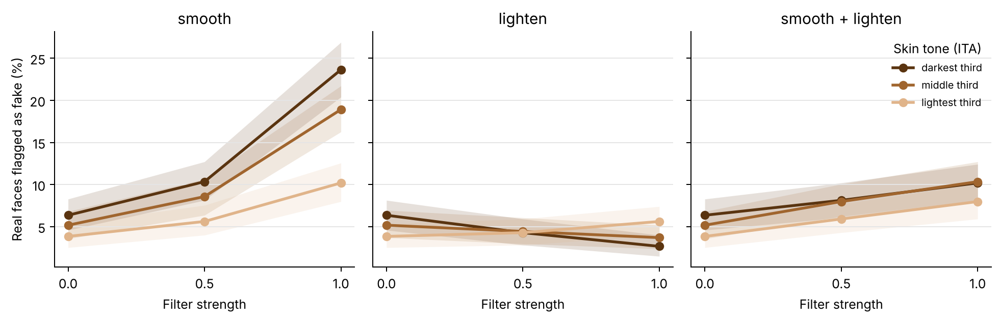

# Filtered, Not Faked

**Beauty filters and skin-tone disparities in deepfake detection.**

Do phone beauty filters (skin smoothing, skin lightening) cause real faces to be flagged as deepfakes, and does the effect fall harder on darker skin?

DSE3140 Computer Vision research project, Department of Data Science and Engineering, Manipal University Jaipur.
Tanishk Gangwar, Garv, Shhorya Agarwal. Paper: [`paper/Filtered_Not_Faked_paper.pdf`](paper/Filtered_Not_Faked_paper.pdf).

## Key results

2,100 real FairFace faces (300 per race group, 7 groups), one pretrained detector, threshold fixed so that 5% of unfiltered faces are flagged. Every image is real, so every "fake" verdict is a false positive.

| Filter | Strength 0 | 0.5 | 1.0 |
|---|---|---|---|
| Smooth | 5.0% | 8.0% | **17.0%** |
| Smooth + lighten | 5.0% | 7.1% | 9.2% |
| Lighten | 5.0% | 4.2% | 3.9% |

- **RQ1.** Smoothing more than triples false positives (odds ratio 4.1 per unit of strength, p < 1e-40). Lightening alone does not raise them.
- **RQ2.** Under full smoothing, the darkest third of faces (by ITA) rises 6.4% to 23.6%, the lightest 3.8% to 10.2%: a gap of 10.9 percentage points (95% CI 6.9 to 14.5). On the odds scale the interaction is not significant (p = 0.10). Indian faces are flagged most: 9.7% unfiltered, 29.7% smoothed.
- **RQ3.** Lightening moves 87% of faces into a different ITA band. Under smooth + lighten, an audit that reads skin tone off the filtered image reports 4.8% false positives for the dark band; the true rate for those people is 11.1%.



## Design

| Piece | Choice |
|---|---|
| Images | FairFace validation split, 300 per race group, 224x224 |
| Skin tone | Individual Typology Angle (ITA) on skin pixels, before and after filtering |
| Treatments | `smooth` (bilateral, skin-masked), `lighten` (+L* up to 25, skin-masked), `smooth_lighten` |
| Strengths | 0 (control), 0.5, 1.0; full sweep via `--strengths 0 0.25 0.5 0.75 1.0` |
| Compression | every version, including the control, saved as JPEG q85 |
| Detector | [prithivMLmods/Deep-Fake-Detector-v2-Model](https://huggingface.co/prithivMLmods/Deep-Fake-Detector-v2-Model) |
| Threshold | fixed on unfiltered images for a pooled 5% FPR, then held constant |
| Main test | logistic `flagged ~ strength * ITA_z`, SEs clustered by image |
| Secondary (post hoc) | ITA thirds, absolute percentage-point effects, linear probability model (`tertile_analysis.py`) |

Filter strength is assigned by the experimenter and applied to the same photo, so each face is its own control and the dose-response estimates are causal.

## Reproduce

```bash
pip install -r requirements.txt

# 1. Download 300 FairFace validation images per race group into data/fairface/<group>/
python download_fairface.py

# 2. Score every face x filter x strength (about 7 min on a T4 GPU; prints seconds per image)
python run_experiment.py --source folder --path data/fairface --n-per-group 300 \
    --detectors prithivMLmods/Deep-Fake-Detector-v2-Model --out results/fairface

# 3. Pre-specified analysis, then the secondary tertile analysis
python analyze.py results/fairface
python tertile_analysis.py results/fairface
```

Timing test first: add `--max-images 20` to step 2. Pipeline check without a GPU or internet: `python run_experiment.py --source synthetic --detectors highfreq --out results/test` (the `highfreq` stand-in is not a deepfake detector; never report its numbers).

Colab: `colab_run.ipynb` expects a zip of this folder that already contains `data/fairface/` (run step 1 first).

## Repository layout

```
fnf/                 filters, ITA skin tone, data loaders, detector wrappers
run_experiment.py    applies filters and scores every version -> scores.csv
analyze.py           FPR tables, bootstrap CIs, regression, label shift, figures
tertile_analysis.py  secondary analysis by ITA thirds
results/fairface/    outputs of the run reported in the paper
paper/               paper PDF and LaTeX source
```

Output files in `results/fairface/`: `scores.csv` (one row per face x filter x strength), `fpr_by_band.csv`, `fpr_by_group.csv`, `regression.csv`, `label_shift.csv`, `measurement_gap.csv`, `tertile_fpr.csv`, `tertile_effects.csv`, figures and `summary.md`.

## Limitations

- One community detector; results may not transfer to standard checkpoints (Xception, EfficientNet).
- ITA on uncontrolled web photos runs dark in absolute terms (median about 0 for White faces), so skin-tone comparisons use relative thirds rather than textbook bands.
- 3.3% of faces had too few skin pixels for an ITA value and are excluded from skin-tone analyses.
- Filters approximate phone beauty modes but are not real app filters.
- The tertile and absolute-scale analyses were added after the main run.
- False positives only; evasion by filtered fakes is not tested.

## Data

FairFace images are not included in this repository. `download_fairface.py` fetches them from the Hugging Face hub ([HuggingFaceM4/FairFace](https://huggingface.co/datasets/HuggingFaceM4/FairFace)). Cite: K. Karkkainen and J. Joo, "FairFace: Face attribute dataset for balanced race, gender, and age," WACV 2021.
