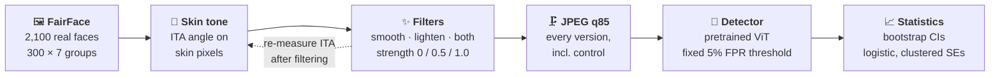

<p align="center">
  
</p>

<p align="center">
  
  
  
  
  
  
</p>

<p align="center">
  <b>Beauty filters and skin-tone disparities in deepfake detection</b><br>
  Tanishk Gangwar · Garv · Shhorya Agarwal<br>
  <sub>DSE3140 Computer Vision · Department of Data Science and Engineering, Manipal University Jaipur · October 2026</sub><br><br>
  <a href="paper/Filtered_Not_Faked_paper.pdf"><b>📄 Paper</b></a> ·
  <a href="#-key-findings"><b>📊 Results</b></a> ·
  <a href="#%EF%B8%8F-reproduce"><b>⚙️ Reproduce</b></a> ·
  <a href="#%EF%B8%8F-limitations"><b>⚠️ Limitations</b></a>
</p>

---

## 💡 The question

Phone cameras and apps **smooth and lighten skin by default**. Deepfake detectors are used to decide whether a photo of a real person is genuine, in content moderation, ID checks and newsrooms. A **false positive** means a real person's photo is called fake.

Prior work shows two things separately: detectors have **unequal error rates across demographic groups** (Trinh & Liu 2021; Hazirbas et al. 2021; Xu et al. 2022), and **beauty filters degrade detection** (Libourel et al. 2024; Concas et al. 2025). Nobody had tested them together, per skin tone, under controlled conditions.

| | Research question |
|---|---|
| **RQ1** | Does applying a beauty filter to a real face increase the chance a detector flags it as a deepfake? |
| **RQ2** | Is that increase larger for darker skin? |
| **RQ3** | Does skin lightening move faces between the skin-tone groups a fairness audit uses, and does that distort the audit? |

---

## 📌 Key findings

> [!IMPORTANT]
> **Smoothing more than triples false positives (5.0% → 17.0%).** The absolute increase is **10.9 points larger** for the darkest third of faces than the lightest (95% CI 6.9 to 14.5). **Indian faces** are flagged most: **29.7%** under full smoothing. Lightening moves **87%** of faces into a different skin-tone band, which can **hide more than half the harm** from an audit.

| | Unfiltered | Full smoothing | Change |
|---|:---:|:---:|:---:|
| All 2,100 faces | 5.0% | **17.0%** | ×3.4 |
| Darkest third (ITA) | 6.4% | **23.6%** | +17.3 pts |
| Lightest third (ITA) | 3.8% | 10.2% | +6.4 pts |
| Indian faces | 9.7% | **29.7%** | +20.0 pts |
| White faces | 4.0% | 8.7% | +4.7 pts |

---

## 🔬 How it works



<table>
<tr>
<td width="44%"></td>
<td>

**Each face is its own control.** We apply the filter, at a strength *we* choose, to the *same* photo. Same person, lighting, pose and compression, so any change in the detector's verdict is **caused by the filter**. Observational fairness audits cannot make that claim.

| Piece | Choice |
|---|---|
| **Data** | FairFace validation split, 300 per race group, 224×224 |
| **Skin tone** | Individual Typology Angle (ITA), median over skin pixels in the central face |
| **Smooth** | bilateral filter on skin, kernel and sigma grow with strength |
| **Lighten** | L\* +25×strength on skin, redness (a\*) reduced |
| **Detector** | [Deep-Fake-Detector-v2](https://huggingface.co/prithivMLmods/Deep-Fake-Detector-v2-Model) (ViT, classes Realism / Deepfake) |
| **Threshold** | set once on unfiltered faces for 5% FPR (0.745), then held fixed |
| **Test** | `flagged ~ strength × ITA_z`, logistic, SEs clustered by face |

</td>
</tr>
</table>

Every image is real, so **every "fake" verdict is a false positive**. The full run produced **18,900 detector scores**.

---

## 📊 Results

### RQ1 · Do filters cause false positives?

<p align="center"></p>

| Filter | Strength 0 | 0.5 | 1.0 | Odds ratio per unit strength | p |
|---|:---:|:---:|:---:|:---:|:---:|
| **Smooth** | 5.0% | 8.0% | **17.0%** | 4.11 | 3×10⁻⁴² |
| Smooth + lighten | 5.0% | 7.1% | 9.2% | 1.98 | 3×10⁻⁹ |
| Lighten | 5.0% | 4.2% | 3.9% | 0.78 | 0.029 |

**Yes for smoothing, no for lightening alone.** Removing skin texture is what this detector reads as synthetic.

### RQ2 · Is it worse for darker skin?

<p align="center"></p>

| Filter (none → full) | Darkest third | Lightest third | Gap, points [95% CI] |
|---|:---:|:---:|:---:|
| **Smooth** | +17.3 | +6.4 | **+10.9 [6.9, 14.5]** |
| Lighten | −3.7 | +1.8 | −5.5 [−7.8, −3.4] |
| Smooth + lighten | +3.8 | +4.1 | −0.3 [−3.7, 3.0] |

> [!NOTE]
> **Two scales, two answers.** On the odds scale the smoothing × skin-tone interaction is **not significant** (OR 0.84 per SD of ITA, p = 0.10): smoothing multiplies everyone's odds by a similar factor. But darker faces start higher (6.4% vs 3.8%), so they lose about **2.7× more in absolute terms**, and a linear probability model confirms it (p = 3×10⁻¹⁰). For the person whose photo is rejected, the absolute rate is what matters. Lightening does the opposite: it makes darker faces *less* likely to be flagged.

#### By FairFace race group

<p align="center"></p>

Nearly **1 in 3** smoothed Indian faces is called fake, against **1 in 11** White faces. Black faces have the lowest measured ITA but start among the lowest false-positive rates (3.0%), so race-group differences are **not explained by skin tone alone**.

### RQ3 · The measurement trap

<p align="center"></p>

A fairness audit groups people by skin tone. If it measures skin tone **from the filtered photo**, lightened faces are counted in a lighter group, and their errors move with them. Under full smooth + lighten, the dark band looks like **4.8%** false positives; the true rate for people who are dark before filtering is **11.1%**.

> [!TIP]
> **Recommendation:** measure demographic attributes on the **unmodified** image, or record them from the person, never from the image being scored.

---

## ⚙️ Reproduce

```bash
git clone https://github.com/tanistheta/filtered-not-faked.git
cd filtered-not-faked
pip install -r requirements.txt
```

**1 · Get the data** (300 FairFace validation images per race group → `data/fairface/<group>/`)
```bash
python download_fairface.py
```

**2 · Timing test** (20 images; prints seconds per image)
```bash
python run_experiment.py --source folder --path data/fairface --max-images 20 \
    --detectors prithivMLmods/Deep-Fake-Detector-v2-Model --out results/timing
```

**3 · Full run** (about 7 min on a T4 GPU)
```bash
python run_experiment.py --source folder --path data/fairface --n-per-group 300 \
    --detectors prithivMLmods/Deep-Fake-Detector-v2-Model --out results/fairface
```

**4 · Analyse**
```bash
python analyze.py results/fairface            # pre-specified analysis
python tertile_analysis.py results/fairface   # secondary analysis by ITA thirds
```

<details>
<summary><b>More options</b></summary>

| Flag | Default | Meaning |
|---|---|---|
| `--n-per-group` | 75 | images per group |
| `--strengths` | `0 0.5 1.0` | full sweep: `0 0.25 0.5 0.75 1.0` |
| `--filters` | all three | any of `smooth lighten smooth_lighten` |
| `--detectors` | `highfreq` | Hugging Face model ids; `id::FakeLabel` if labels are ambiguous |
| `--jpeg-quality` | 85 | `0` disables the JPEG save |
| `--max-images` | 0 | stop early, for timing tests |

**No GPU or internet?** Check the pipeline with synthetic images and a stand-in detector (its numbers mean nothing):
```bash
python run_experiment.py --source synthetic --detectors highfreq --out results/test
```

**Google Colab:** open `colab_run.ipynb` with a T4 GPU and upload a zip of this folder that already contains `data/fairface/` (run step 1 first).

</details>

<details>
<summary><b>Output files</b></summary>

| File | Contents |
|---|---|
| `scores.csv` | one row per face × filter × strength: ITA before/after, band, detector score |
| `fpr_by_band.csv` / `fpr_by_group.csv` | FPR with 95% bootstrap CIs by ITA band / race group |
| `regression.csv` | logistic model terms, odds ratios, clustered p-values |
| `label_shift.csv` | share of faces changing skin-tone band |
| `measurement_gap.csv` | FPR by true band vs band read off the filtered image |
| `tertile_fpr.csv` / `tertile_effects.csv` | secondary analysis by ITA thirds |
| `fig_*.png`, `summary.md` | figures and plain-language summary |

</details>

---

## 🗂️ Repository layout

```
filtered-not-faked/
├── fnf/
│   ├── data.py           # FairFace, local-folder and synthetic loaders
│   ├── filters.py        # skin mask, smoothing, lightening, JPEG
│   ├── skintone.py       # ITA and skin-tone bands
│   └── detectors.py      # Hugging Face detector wrapper + stand-in
├── run_experiment.py     # filter every face, score every version
├── analyze.py            # FPR tables, CIs, regression, label shift, figures
├── tertile_analysis.py   # secondary analysis by ITA thirds
├── download_fairface.py  # fetch the 2,100 FairFace images
├── colab_run.ipynb       # one-click Colab run
├── results/fairface/     # outputs of the run reported in the paper
├── paper/                # paper PDF + LaTeX source
└── docs/                 # README figures
```

---

## ⚠️ Limitations

| Limitation | What it means |
|---|---|
| **One detector** | A community ViT model; results may not transfer to standard checkpoints (Xception, EfficientNet). |
| **ITA runs dark** | On uncontrolled web photos even White faces have median ITA ≈ 0°, so textbook band names are not literal. Skin-tone comparisons use relative thirds instead. |
| **Simulated filters** | Bilateral smoothing and an L\* lift approximate phone beauty modes but are not real app filters. |
| **Post-hoc analyses** | The tertile and absolute-scale tests were added after the main run, and are labelled so in the paper. |
| **ITA failures** | 3.3% of faces had too few skin pixels (1.7% to 5.0% by group) and are excluded from skin-tone analyses. |
| **False positives only** | Whether filters help real deepfakes evade detection is not tested. |

**Next:** standard detectors · real phone-filtered photos taken with consent · human Monk Skin Tone labels (Casual Conversations v2) · filter-aware training as a mitigation.

---

## 📚 Data and citation

FairFace images are **not included**; `download_fairface.py` fetches them from the Hugging Face hub ([HuggingFaceM4/FairFace](https://huggingface.co/datasets/HuggingFaceM4/FairFace)).

> K. Karkkainen and J. Joo, "FairFace: Face attribute dataset for balanced race, gender, and age," WACV 2021.

To cite this project:

```bibtex
@misc{gangwar2026filtered,
  title  = {Filtered, Not Faked: Beauty Filters and Skin-Tone Disparities in Deepfake Detection},
  author = {Gangwar, Tanishk and Garv and Agarwal, Shhorya},
  year   = {2026},
  note   = {DSE3140 Computer Vision, Manipal University Jaipur},
  url    = {https://github.com/tanistheta/filtered-not-faked}
}
```
